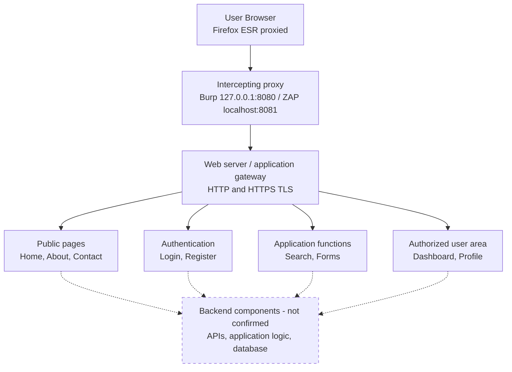

# Attack Surface Map

Illustrative architecture. Solid = observed; dashed = expected, unconfirmed. Replace with real observations.

## Observed external dependencies (practice site)

| Category | Observation |
|---|---|
| Web server | gws |
| Protocol | HTTP/2 over TLS; alt-svc advertises HTTP/3 |
| Redirect | google.com -> https://www.google.com/ (301) |
| Cookies | AEC, NID, __Secure-STRP |
| Third-party hosts | www.gstatic.com, fonts.gstatic.com, csp.withgoogle.com |
| Browser-side security | Report-only CSP, X-Frame-Options SAMEORIGIN |
